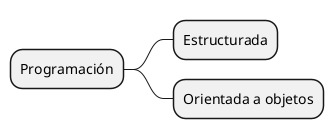

# plantuml-myst

Diagramas de [PlantUML](https://plantuml.com) en sitios y libros de
[MyST](https://mystmd.org) (`mystmd`): un plugin que los dibuja al construir y una GitHub
Action que deja PlantUML listo en CI.

````markdown
```plantuml
actor Estudiante
Estudiante -> Sitio : GET /apunte
Sitio --> Estudiante : HTML
```
````

- **Plugin** (`src/plantuml-myst.mjs`): un único archivo sin dependencias. Dibuja los bloques
  ```` ```plantuml ```` / ```` ```puml ```` y la directiva `{plantuml}` (figuras numeradas,
  diagramas en archivos aparte, themes).
- **Action** (`action.yml`): instala Java, Graphviz y el `.jar` oficial de PlantUML (con el
  SHA-256 verificado) y dibuja de antemano todos los diagramas del proyecto, con caché entre
  builds.
- **Scripts**: instalar PlantUML localmente, pre-renderizar o verificar los diagramas de un
  proyecto, y actualizar el plugin en los sitios.

Requisitos para construir: Node 18 o más (mystmd 1.14 pide 22), Java 11 o más y, para
diagramas de clases, componentes, estados, etc., Graphviz.

## Usarlo en un sitio

### 1. El plugin

Copiá el plugin en el sitio y cargalo desde el `myst.yml`:

```bash
mkdir -p plugins
cp ruta/a/plantuml-myst/src/plantuml-myst.mjs plugins/
# o, con un release publicado:
curl -L -o plugins/plantuml-myst.mjs \
  https://github.com/INGCOM-UNRN/plantuml-myst/releases/latest/download/plantuml-myst.mjs
```

```yaml
# myst.yml
project:
  plugins:
    - plugins/plantuml-myst.mjs
```

Con el archivo versionado en el sitio, el build no depende de la red y se actualiza con un
procedimiento explícito ([Actualizar el plugin](#actualizar-el-plugin-en-los-sitios)).
También se puede cargar por URL (`https://github.com/INGCOM-UNRN/plantuml-myst/releases/download/vX.Y.Z/plantuml-myst.mjs`)
una vez que haya releases.

### 2. PlantUML local

```bash
scripts/instalar-plantuml.sh            # la versión fijada; o una versión, o "latest"
```

Descarga el `.jar` oficial en `~/.local/share/plantuml/`, verifica su SHA-256 y crea el
comando `~/.local/bin/plantuml`. Si ya tenés un comando `plantuml`, el plugin lo usa; también
se puede indicar el `.jar` con `PLANTUML_JAR=/ruta/plantuml.jar`.

### 3. GitHub Actions

Antes de `myst build`, en el workflow que publica el sitio:

```yaml
      - uses: actions/setup-node@v7
        with:
          node-version: 24
      - uses: INGCOM-UNRN/plantuml-myst@main      # o @v0.1.0 cuando haya releases
        with:
          proyecto: .                             # directorio del myst.yml
      - run: npm install -g mystmd
      - run: myst build --html
```

| Entrada | Por omisión | |
|---|---|---|
| `plantuml-version` | la fijada | Versión de PlantUML (`1.2026.10`) o `latest`. |
| `java-version` | `21` | Java Temurin a instalar; vacío usa el del runner. |
| `graphviz` | `true` | Instalar Graphviz. |
| `proyecto` | (vacío) | Con un directorio, dibuja de antemano sus diagramas y guarda la caché entre builds. |
| `estricto` | `false` | Con `proyecto`, falla si algún diagrama tiene errores. |
| `plugin` | (vacío) | Ruta donde copiar `plantuml-myst.mjs` de la misma versión que la action, para sitios que no lo versionan. |

Salidas: `plantuml-jar` y `plantuml-version`. La action deja `PLANTUML_JAR` y el comando
`plantuml` para los pasos siguientes. Funciona en runners Linux y macOS.

## Escribir diagramas

Un bloque `plantuml` o `puml`; `@startuml`/`@enduml` son opcionales. Otros tipos van con su
`@start…` (`@startmindmap`, `@startgantt`, `@startjson`, …):

````markdown

````

Para mostrar el código de un diagrama sin dibujarlo (una guía de PlantUML, por ejemplo), usá
`{code}`: los bloques ```` ```{code} plantuml ```` y ```` ```{code-block} plantuml ```` quedan
como código.

La directiva `{plantuml}` (alias `{uml}`) agrega opciones. Con `:caption:` o `:label:` el
diagrama es una figura numerada que se puede referenciar:

````markdown
:::{plantuml}
:caption: Jerarquía de figuras.
:label: fig-figuras
:width: 70%
abstract class Figura
Figura <|-- Circulo
:::

Como muestra la [](#fig-figuras)…
````

El diagrama también puede estar en un archivo, relativo a la página:

````markdown
```{plantuml} diagramas/estados.puml
:caption: Estados de un proceso.
```
````

| Opción | |
|---|---|
| `:theme:` | Theme de PlantUML (`!theme`): `plain`, `mars`, `cerulean`, … |
| `:width:`, `:align:`, `:class:` | Tamaño, alineación (`left`, `center`, `right`) y clases CSS de la imagen. |
| `:alt:` | Texto alternativo; por omisión, el `title` del diagrama o su tipo. |
| `:caption:`, `:label:` | Epígrafe y etiqueta de la figura. |

Los `!include` relativos se resuelven desde la página (o desde el archivo `.puml` de la
directiva). Si cambia un archivo incluido, los diagramas que lo usan se vuelven a dibujar.

Un diagrama con errores se muestra en la página como un recuadro con el mensaje de PlantUML y
la línea del diagrama, y `myst build --strict` falla.

### Variables de entorno

| Variable | |
|---|---|
| `PLANTUML_JAR` | `.jar` de PlantUML, ejecutado con `java -jar`. |
| `PLANTUML` | Comando de PlantUML si no hay `PLANTUML_JAR` (por omisión, `plantuml`). |
| `PLANTUML_MYST_TEMA` | Theme por omisión de todos los diagramas. |
| `PLANTUML_MYST_CONFIG` | Archivo `.puml` con `skinparam` comunes, que se agrega a cada diagrama. |
| `PLANTUML_MYST_SALIDA` | `embebido` (por omisión): el SVG va en la página. `diagramas`: escribe `diagramas/plantuml-<hash>.svg` al lado de cada página. |
| `PLANTUML_MYST_CACHE` | Directorio de la caché (por omisión `_build/plantuml`). |

## Caché y pre-renderizado

PlantUML corre en Java y cada ejecución tarda un par de segundos. Por eso el plugin dibuja
todos los diagramas nuevos de una página en una sola ejecución y guarda cada SVG en
`_build/plantuml/`, con el contenido del diagrama (y de lo que incluye) como clave: un
diagrama que no cambió no se vuelve a dibujar, tampoco con `myst start`.

`scripts/prerenderizar.mjs` dibuja de una vez los diagramas de todo un proyecto, y es lo que
hace la action con `proyecto:`:

```bash
node scripts/prerenderizar.mjs ruta/al/sitio             # llena ruta/al/sitio/_build/plantuml
node scripts/prerenderizar.mjs --estricto ruta/al/sitio  # además, falla si hay errores
```

Con `--estricto` sirve para verificar los diagramas (en un hook o en CI) sin construir el
sitio. Para forzar que se vuelva a dibujar todo, borrá `_build/plantuml`.

## Actualizar el plugin en los sitios

Los sitios guardan una copia del plugin en `plugins/plantuml-myst.mjs`. Para actualizarla:

```bash
# desde este repositorio, con la versión de src/:
scripts/actualizar-sitio.sh --commit ../../c/contenido/apunte ../../java/contenido/apunte
# o con un release publicado (verifica su SHA256SUMS):
scripts/actualizar-sitio.sh --release v0.2.0 --commit SITIO...
```

Para cada sitio, el script:

1. comprueba que el `myst.yml` cargue `plugins/plantuml-myst.mjs`;
2. no hace nada si la copia ya es idéntica;
3. copia el plugin nuevo y construye el sitio con `myst build --site`. Si el build falla, el
   plugin no carga o informa errores, restaura la copia anterior y muestra el log;
4. con `--commit`, hace el commit sólo de `plugins/plantuml-myst.mjs`
   (`build(myst): actualizar plantuml-myst a X.Y.Z`). Nunca hace push.

Revisá el resultado y hacé el push de cada sitio. `--sin-probar` saltea el build (por
ejemplo, si no hay PlantUML en la máquina).

Para que los sitios que usan la action tomen una versión nueva de PlantUML, cambiá
`VERSION_FIJADA` en `scripts/instalar-plantuml.sh` (el workflow de mantenimiento avisa
cuando hay una nueva y prueba todo con ella cada semana), o fijá `plantuml-version` en el
workflow del sitio.

## Desarrollo

```bash
npm test                     # pruebas del plugin y del pre-renderizado (necesitan PlantUML)
bash scripts/probar-sitio.sh # construye ejemplo/ con mystmd y verifica los diagramas
```

El CI prueba la action (`uses: ./`) en Linux y macOS, las pruebas y el sitio de ejemplo. El
workflow de mantenimiento corre lo mismo los lunes con la última versión de PlantUML.

Release: `git tag vX.Y.Z && git push origin vX.Y.Z` (el tag tiene que coincidir con
`package.json` y con `VERSION` en `src/plantuml-myst.mjs`). Publica `plantuml-myst.mjs` y
`SHA256SUMS`, y el tag sirve como versión de la action.

## Licencia

GPL-3.0-or-later. PlantUML se descarga de su repositorio oficial y tiene su propia licencia.
