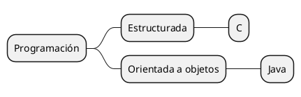

# plantuml-myst

Diagramas de [PlantUML](https://plantuml.com) escritos dentro de las páginas de MyST.

Un bloque de código `plantuml` (o `puml`) se reemplaza por el diagrama. `@startuml` y
`@enduml` son opcionales:

```plantuml
title Pedido de una página
actor Estudiante
participant "Sitio MyST" as Sitio
Estudiante -> Sitio : GET /diagramas
Sitio --> Estudiante : HTML con el diagrama
```

Otros tipos de diagrama usan su propio `@start…`:



Para *mostrar* el código de un diagrama sin dibujarlo (por ejemplo, en una guía de
PlantUML), usá la directiva `{code}`:

```{code} plantuml
:caption: El código, sin dibujar.
@startuml
Alice -> Bob : hola
@enduml
```

En [](diagramas.md) están la directiva `{plantuml}`, las figuras numeradas y los diagramas en
archivos aparte.
